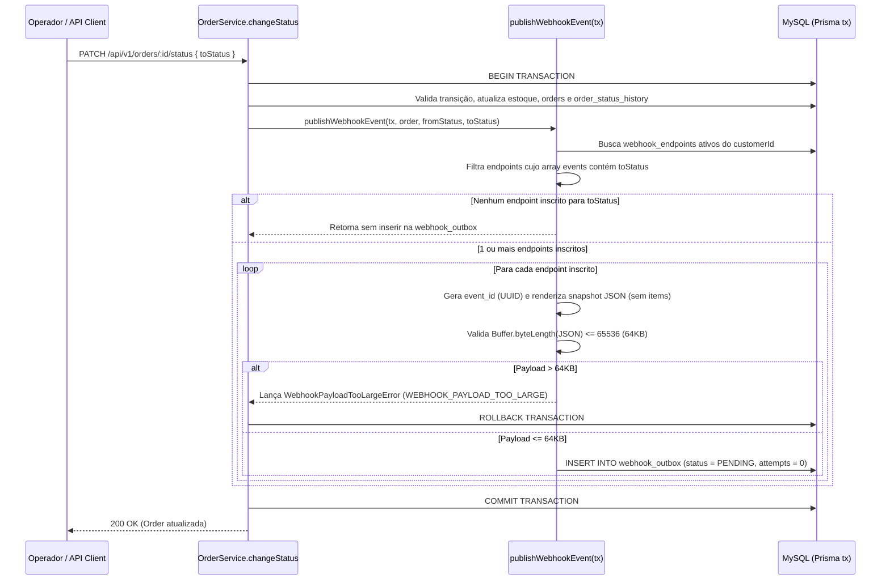
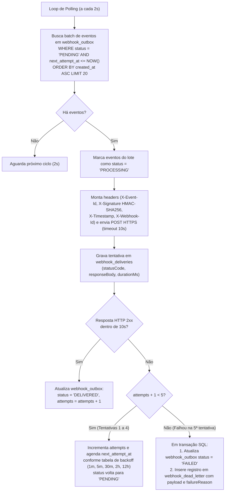

# FDD — Feature Design Document: Sistema de Webhooks de Notificação de Pedidos

| Metadado | Valor |
| :--- | :--- |
| **Feature** | Sistema de Webhooks de Notificação de Pedidos (Outbound) |
| **Módulo Alvo** | `src/modules/webhooks/` e `src/worker.ts` |
| **Documentos Relacionados** | [PRD](./PRD.md) \| [RFC-001](./RFC.md) \| [ADR-001](./adrs/ADR-001-padrao-outbox-no-mysql.md) a [ADR-006](./adrs/ADR-006-reuso-dos-padroes-existentes-do-projeto.md) |
| **Estimativa de Implementação** | 3 Sprints (incluindo 2 dias úteis de revisão de segurança pela Sofia) |

---

## 1. Contexto e Motivação Técnica

O Order Management System (`order-management-api`) gerencia pedidos B2B com máquina de estados estrita (`PENDING`, `PAID`, `PROCESSING`, `SHIPPED`, `DELIVERED`, `CANCELLED` em `src/modules/orders/order.status.ts`), controle transacional de estoque e trilha de auditoria em `order_status_history` (`src/modules/orders/order.service.ts`). Contudo, a aplicação não possui eventos assíncronos nem notificações externas, obrigando clientes B2B (Atlas Comercial, MaxDistribuição e Nova Cargo) a realizarem *polling* repetitivo em `GET /api/v1/orders` (`[09:00] Marcos`).

Este FDD especifica em nível de implementação como construir o módulo de **Outbound Webhooks** garantindo atomicidade transacional com a mudança de status do pedido (`prisma.$transaction`), entrega assíncrona em `< 10 segundos` via worker separado em polling de 2 segundos, segurança criptográfica HMAC-SHA256 com rotação de secret, política de retry exponencial (5 tentativas) e Dead Letter Queue (DLQ) com replay administrativo (`[09:48] Larissa`).

---

## 2. Objetivos Técnicos

1. **Atomicidade SQL Absoluta:** Garantir que nenhuma transição em `OrderService.changeStatus` seja commitada sem o correspondente registro na tabela `webhook_outbox` (quando houver webhook inscrito no status), e que qualquer rollback da transação desfaça igualmente o evento ([ADR-001](./adrs/ADR-001-padrao-outbox-no-mysql.md), `[09:06] Diego`, `[09:40] Bruno`).
2. **Baixa Latência de Disparo (`< 10s`):** Processar eventos pendentes em loop de polling a cada **2 segundos** em um processo Node.js separado (`src/worker.ts`), isolado do processo HTTP da API (`src/server.ts`) ([ADR-002](./adrs/ADR-002-worker-em-processo-separado-com-polling.md), `[09:02] Marcos`, `[09:09] Diego`, `[09:11] Diego`).
3. **Resiliência e Recuperação:** Absorver indisponibilidades de até ~15 horas nos servidores dos clientes via **5 tentativas de retry com backoff exponencial** (`1m`, `5m`, `30m`, `2h`, `12h`) e timeout HTTP de **10 segundos**, movendo falhas permanentes para `webhook_dead_letter` com replay manual restrito a `ADMIN` ([ADR-003](./adrs/ADR-003-politica-de-retry-com-backoff-e-dlq.md), `[09:17] Diego`, `[09:18] Diego`, `[09:36] Sofia`, `[09:42] Diego`).
4. **Segurança e Idempotência:** Assinar todo payload (limite máximo de **64KB**) com **HMAC-SHA256** usando secret exclusiva por endpoint, suportar rotação com *grace period* de **24 horas**, exigir URLs `https://` e fornecer `X-Event-Id` (UUID) para deduplicação *at-least-once* no cliente ([ADR-004](./adrs/ADR-004-autenticacao-hmac-sha256-e-rotacao-de-secret.md), [ADR-005](./adrs/ADR-005-garantia-at-least-once-com-x-event-id.md), `[09:21] Sofia`, `[09:23] Sofia`, `[09:24] Diego`, `[09:25] Diego`).
5. **Aderência aos Padrões da Codebase:** Reutilizar integralmente `AppError` (com prefixo `WEBHOOK_`), `errorMiddleware`, `validate` (Zod), `authenticate` / `requireRole`, `logger` (Pino) e paginação `paginated` ([ADR-006](./adrs/ADR-006-reuso-dos-padroes-existentes-do-projeto.md), `[09:27]–[09:30] Bruno/Larissa`).

---

## 3. Escopo e Exclusões Técnicas

### 3.1. Escopo Técnico Incluso
- Modelagem Prisma de 4 novas tabelas: `webhook_endpoints`, `webhook_outbox`, `webhook_deliveries` e `webhook_dead_letter` com chaves UUID `@db.Char(36)` (`[09:10] Diego`, `[09:18] Diego`, `[09:21] Bruno`, `[09:34] Marcos`, `[09:51] Larissa`).
- Função transacional `publishWebhookEvent(tx, order, fromStatus, toStatus)` integrada ao método `OrderService.changeStatus` com filtragem na inserção e snapshot JSON (`[09:34] Bruno`, `[09:41] Bruno`, `[09:52] Larissa`).
- Entry-point `src/worker.ts` (`npm run worker`) e processador `src/modules/webhooks/webhook.worker.ts` (`[09:11] Larissa`, `[09:28] Bruno`).
- API REST completa de configuração de webhooks, rotação de secret, listagem das últimas 100 entregas e replay administrativo de DLQ (`[09:21] Sofia`, `[09:31]–[09:36] Marcos/Bruno/Diego/Sofia`).

### 3.2. Exclusões Técnicas (Fora de Escopo)
- **Webhooks Inbound:** O sistema apenas envia notificações; não recebe webhooks externos (`[09:02] Marcos`, `[09:03] Sofia`).
- **Notificação por E-mail em Falhas Consecutivas:** Alertas por e-mail após 3 falhas seguidas foram adiados para fase futura (`[09:37] Larissa`).
- **Dashboard Visual / Painel Frontend:** Entrega restrita a endpoints de API REST (`[09:39] Marcos`, `[09:40] Larissa`).
- **Rate Limiting de Saída por Cliente:** Será apenas monitorado em produção nesta fase (`[09:38] Diego`, `[09:39] Larissa`).
- **Job de Arquivamento de Registros Entregues (> 30 dias):** A limpeza automática de linhas antigas da outbox fica fora desta entrega (`[09:08] Diego`).
- **Particionamento Multi-Worker / Lock Pessimista:** Operação inicial será *single-worker* com ordenação implícita (`[09:12] Diego`, `[09:13] Diego`).

---

## 4. Modelagem de Dados (`prisma/schema.prisma`)

Todas as novas entidades seguem as convenções de `prisma/schema.prisma`: chaves primárias `String @id @default(uuid()) @db.Char(36)` (`[09:51] Larissa`), mapeamento `@@map` em `snake_case` e índices explícitos para performance de consulta (`[09:08] Diego`).

```prisma
enum WebhookOutboxStatus {
  PENDING
  PROCESSING
  DELIVERED
  FAILED
}

model WebhookEndpoint {
  id                      String    @id @default(uuid()) @db.Char(36)
  customerId              String    @db.Char(36)
  url                     String    @db.VarChar(500)
  secret                  String    @db.VarChar(128)
  previousSecret          String?   @db.VarChar(128)
  previousSecretExpiresAt DateTime?
  events                  Json      // Array de OrderStatus inscritos, ex: ["SHIPPED", "DELIVERED"]
  active                  Boolean   @default(true)
  createdAt               DateTime  @default(now())
  updatedAt               DateTime  @updatedAt

  customer    Customer            @relation(fields: [customerId], references: [id], onDelete: Cascade)
  outboxItems WebhookOutbox[]
  deliveries  WebhookDelivery[]
  deadLetters WebhookDeadLetter[]

  @@index([customerId, active])
  @@map("webhook_endpoints")
}

model WebhookOutbox {
  id            String              @id @default(uuid()) @db.Char(36) // Usado como event_id e X-Event-Id
  webhookId     String              @db.Char(36)
  orderId       String              @db.Char(36)
  eventType     String              @default("order.status_changed") @db.VarChar(64)
  payload       Json                // Snapshot JSON renderizado no momento da transição (máx 64KB)
  status        WebhookOutboxStatus @default(PENDING)
  attempts      Int                 @default(0)
  nextAttemptAt DateTime            @default(now())
  lastError     String?             @db.VarChar(1000)
  createdAt     DateTime            @default(now())
  updatedAt     DateTime            @updatedAt

  webhook    WebhookEndpoint   @relation(fields: [webhookId], references: [id], onDelete: Cascade)
  deliveries WebhookDelivery[]

  @@index([status, nextAttemptAt, createdAt])
  @@index([orderId])
  @@map("webhook_outbox")
}

model WebhookDelivery {
  id             String   @id @default(uuid()) @db.Char(36)
  webhookId      String   @db.Char(36)
  outboxEventId  String   @db.Char(36)
  attemptNumber  Int
  success        Boolean
  statusCode     Int?
  requestPayload Json
  responseBody   String?  @db.Text
  errorMessage   String?  @db.VarChar(500)
  durationMs     Int
  deliveredAt    DateTime @default(now())

  webhook     WebhookEndpoint @relation(fields: [webhookId], references: [id], onDelete: Cascade)
  outboxEvent WebhookOutbox   @relation(fields: [outboxEventId], references: [id], onDelete: Cascade)

  @@index([webhookId, deliveredAt(sort: Desc)])
  @@index([outboxEventId])
  @@map("webhook_deliveries")
}

model WebhookDeadLetter {
  id            String    @id @default(uuid()) @db.Char(36)
  webhookId     String    @db.Char(36)
  outboxEventId String    @unique @db.Char(36)
  orderId       String    @db.Char(36)
  payload       Json
  failureReason String    @db.VarChar(1000)
  attemptsMade  Int       @default(5)
  failedAt      DateTime  @default(now())
  replayedAt    DateTime?
  replayedById  String?   @db.Char(36)

  webhook WebhookEndpoint @relation(fields: [webhookId], references: [id], onDelete: Cascade)

  @@index([webhookId, failedAt])
  @@map("webhook_dead_letter")
}
```

---

## 5. Fluxos Detalhados

### 5.1. Fluxo 1: Mudança de Status e Inserção Transacional na Outbox

Executado dentro de `OrderService.changeStatus` (`src/modules/orders/order.service.ts`) via chamada à função pura `publishWebhookEvent(tx, order, fromStatus, toStatus)` (`[09:40] Bruno`, `[09:41] Bruno`, `[09:41] Diego`):



### 5.2. Fluxo 2: Processamento pelo Worker em Polling (2s), Retry e DLQ

O processo `src/worker.ts` executa um ciclo a cada **2000ms** (`[09:09] Diego`, `[09:11] Larissa`):



**Tabela de Progressão do Backoff Exponencial (`[09:17] Diego`, `[09:17] Larissa`):**

| Falha do Disparo | Tentativa de Retry Agendada | Intervalo de Espera (`backoff`) | Tempo Acumulado desde a Falha Inicial | Destino em Caso de Nova Falha |
| :---: | :---: | :---: | :---: | :--- |
| Falha no envio inicial | Retry #1 | `+ 1 minuto` | `0h 01m` | Agenda Retry #2 |
| Falha no Retry #1 | Retry #2 | `+ 5 minutos` | `0h 06m` | Agenda Retry #3 |
| Falha no Retry #2 | Retry #3 | `+ 30 minutos` | `0h 36m` | Agenda Retry #4 |
| Falha no Retry #3 | Retry #4 | `+ 2 horas` (120m) | `2h 36m` | Agenda Retry #5 |
| Falha no Retry #4 | Retry #5 (Última) | `+ 12 horas` (720m) | `14h 36m` (~15h) | Move para `webhook_dead_letter` (DLQ) |

### 5.3. Fluxo 3: Replay Manual de DLQ por Administrador

1. Usuário autenticado com role `ADMIN` envia `POST /api/v1/admin/webhooks/dead-letter/:id/replay` (`[09:18] Diego`, `[09:35] Diego`, `[09:36] Sofia`).
2. Os middlewares `authenticate` e `requireRole('ADMIN')` (`src/middlewares/auth.middleware.ts`) validam o token JWT (`[09:36] Larissa`).
3. O serviço localiza o registro em `webhook_dead_letter` (lançando `WEBHOOK_DEAD_LETTER_NOT_FOUND` caso não exista ou `WEBHOOK_REPLAY_CONFLICT` caso já tenha sido reprocessado).
4. Em transação `prisma.$transaction`:
   - Atualiza a linha correspondente em `webhook_outbox` para `status = 'PENDING'`, `attempts = 0`, `nextAttemptAt = new Date()`, mantendo o mesmo `id` (`X-Event-Id`) e `payload` snapshot original (`[09:18] Diego`);
   - Registra `replayedAt = new Date()` e `replayedById = req.user.id` em `webhook_dead_letter`.
5. Registra log estruturado de auditoria no Pino (`logger.info({ deadLetterId, outboxEventId, adminUserId: req.user.id }, 'webhook_dlq_replayed')`) (`[09:36] Sofia`).


---

## 6. Contratos Públicos (API HTTP e Payload Outbound)

Todas as rotas da API seguem o prefixo `/api/v1` configurado em `src/app.ts` e exigem autenticação Bearer JWT via middleware `authenticate` (`src/middlewares/auth.middleware.ts`). O `customerId` é informado explicitamente no body ou query (não vem do JWT, pois o JWT identifica o usuário operador/representante em `users`) (`[09:32] Bruno`, `[09:32] Marcos`, `[09:32] Larissa`).

### 6.1. Contrato Outbound (Disparo do Worker para o Endpoint do Cliente B2B)

- **Método e Transporte:** `POST <webhook.url>` sobre `HTTPS` obrigatório (`[09:23] Sofia`).
- **Timeout:** `10000ms` (10 segundos) (`[09:42] Diego`).
- **Tamanho Máximo do Payload:** `64KB` (`65536 bytes`) (`[09:24] Diego`, `[09:24] Larissa`).
- **Semântica de Sucesso:** Qualquer status HTTP `2xx` (`200`–`299`) retornado em até 10s marca a entrega como `DELIVERED`. Respostas `3xx`, `4xx`, `5xx`, erros de rede/TLS ou timeout (> 10s) disparam a política de retry (`[09:15] Diego`, `[09:42] Diego`).

**Headers Enviados pelo Worker (`[09:20] Sofia`, `[09:25] Diego`, `[09:44] Diego`, `[09:44] Sofia`):**

| Header HTTP | Exemplo | Semântica |
| :--- | :--- | :--- |
| `Content-Type` | `application/json` | Formato do payload enviado (`[09:44] Diego`). |
| `X-Event-Id` | `9b1deb4d-3b7d-4bad-9bdd-2b0d7b3dcb6d` | UUID v4 único gerado na entrada da outbox para deduplicação idempotente (*at-least-once*) pelo cliente (`[09:25] Diego`). |
| `X-Webhook-Id` | `3f8a1e2c-91b4-4c5d-8e2a-112233445566` | UUID do cadastro do endpoint de webhook (`[09:44] Sofia`, `[09:45] Diego`). |
| `X-Timestamp` | `2026-10-24T12:30:05.120Z` | Timestamp ISO 8601 do momento do disparo para detecção de *replay attack* pelo receptor (`[09:44] Diego`). |
| `X-Signature` | `sha256=6f8d9a1c...` (ou com assinatura secundária no grace period de 24h) | Assinatura HMAC-SHA256 calculada sobre o corpo JSON bruto usando a `secret` exclusiva do endpoint (`[09:20] Sofia`, `[09:22] Sofia`). |

**Exemplo de Payload Outbound (Snapshot Enxuto Sem `items` — `[09:43] Diego`, `[09:52] Larissa`):**

```json
{
  "event_id": "9b1deb4d-3b7d-4bad-9bdd-2b0d7b3dcb6d",
  "event_type": "order.status_changed",
  "timestamp": "2026-10-24T12:30:03.410Z",
  "order_id": "550e8400-e29b-41d4-a716-446655440000",
  "order_number": "ORD-000042",
  "customer_id": "7c9e6679-7425-40de-944b-e07fc1f90ae7",
  "from_status": "PROCESSING",
  "to_status": "SHIPPED",
  "subtotal_cents": 150000,
  "discount_cents": 5000,
  "total_cents": 145000
}
```

---

### 6.2. Endpoint 1: Cadastrar Webhook (`POST /api/v1/webhooks`)

Cria uma nova configuração de webhook para um `customerId`, valida que a URL utiliza `https://` e retorna a `secret` criptográfica gerada pela plataforma (`[09:23] Sofia`, `[09:31] Marcos`, `[09:32] Larissa`).

- **Autenticação:** `Bearer <JWT>` (`OPERATOR` ou `ADMIN` — `[09:36] Marcos`, `[09:37] Sofia`)
- **Status Codes:** `201 Created` | `400 Bad Request` (`VALIDATION_ERROR` / `WEBHOOK_INVALID_URL`) | `401 Unauthorized` | `404 Not Found` (`WEBHOOK_CUSTOMER_NOT_FOUND`)

**Request Body:**
```json
{
  "customerId": "7c9e6679-7425-40de-944b-e07fc1f90ae7",
  "url": "https://integracao.atlascomercial.com.br/webhooks/orders",
  "events": ["PAID", "PROCESSING", "SHIPPED", "DELIVERED", "CANCELLED"]
}
```

**Response `201 Created`:**
```json
{
  "id": "3f8a1e2c-91b4-4c5d-8e2a-112233445566",
  "customerId": "7c9e6679-7425-40de-944b-e07fc1f90ae7",
  "url": "https://integracao.atlascomercial.com.br/webhooks/orders",
  "secret": "whsec_8f92a7c4e1b0d3f5a6c7e8d9b0a1c2d3e4f5a6b7c8d9e0f1",
  "events": ["PAID", "PROCESSING", "SHIPPED", "DELIVERED", "CANCELLED"],
  "active": true,
  "createdAt": "2026-10-24T12:00:00.000Z",
  "updatedAt": "2026-10-24T12:00:00.000Z"
}
```

---

### 6.3. Endpoint 2: Listar Webhooks de um Cliente (`GET /api/v1/webhooks`)

Retorna a lista paginada de endpoints de webhook configurados (utilizando o helper `paginated` de `src/shared/http/response.ts` e omitindo o valor completo de `secret` por segurança) (`[09:33] Bruno`).

- **Autenticação:** `Bearer <JWT>` (`OPERATOR` ou `ADMIN`)
- **Query Params:** `customerId` (UUID opcional/filtro), `page` (default `1`), `pageSize` (default `20`, máx `100`)
- **Status Codes:** `200 OK` | `400 Bad Request` | `401 Unauthorized`

**Response `200 OK`:**
```json
{
  "data": [
    {
      "id": "3f8a1e2c-91b4-4c5d-8e2a-112233445566",
      "customerId": "7c9e6679-7425-40de-944b-e07fc1f90ae7",
      "url": "https://integracao.atlascomercial.com.br/webhooks/orders",
      "events": ["SHIPPED", "DELIVERED"],
      "active": true,
      "createdAt": "2026-10-24T12:00:00.000Z",
      "updatedAt": "2026-10-24T12:10:00.000Z"
    }
  ],
  "pagination": {
    "page": 1,
    "pageSize": 20,
    "total": 1,
    "totalPages": 1
  }
}
```

---

### 6.4. Endpoint 3: Atualizar Webhook (`PATCH /api/v1/webhooks/:id`)

Permite atualizar a `url` (validando `https://`), a lista de `events` (status de pedido assinados) ou o estado `active` do endpoint (`[09:33] Bruno`, `[09:33] Marcos`).

- **Autenticação:** `Bearer <JWT>` (`OPERATOR` ou `ADMIN`)
- **Status Codes:** `200 OK` | `400 Bad Request` (`WEBHOOK_INVALID_URL`) | `401 Unauthorized` | `404 Not Found` (`WEBHOOK_NOT_FOUND`)

**Request Body:**
```json
{
  "url": "https://erp.atlascomercial.com.br/api/oms-webhook",
  "events": ["SHIPPED", "DELIVERED"],
  "active": true
}
```

**Response `200 OK`:**
```json
{
  "id": "3f8a1e2c-91b4-4c5d-8e2a-112233445566",
  "customerId": "7c9e6679-7425-40de-944b-e07fc1f90ae7",
  "url": "https://erp.atlascomercial.com.br/api/oms-webhook",
  "events": ["SHIPPED", "DELIVERED"],
  "active": true,
  "createdAt": "2026-10-24T12:00:00.000Z",
  "updatedAt": "2026-10-24T12:15:00.000Z"
}
```

---

### 6.5. Endpoint 4: Remover Webhook (`DELETE /api/v1/webhooks/:id`)

Remove o endpoint de webhook (`[09:33] Bruno`).

- **Autenticação:** `Bearer <JWT>` (`OPERATOR` ou `ADMIN`)
- **Status Codes:** `204 No Content` | `401 Unauthorized` | `404 Not Found` (`WEBHOOK_NOT_FOUND`)

---

### 6.6. Endpoint 5: Rotacionar Secret (`POST /api/v1/webhooks/:id/rotate-secret`)

Gera uma nova `secret` para o endpoint e move a `secret` atual para `previousSecret` com validade paralela de **24 horas** (`previousSecretExpiresAt = now + 24h`) (`[09:21] Sofia`, `[09:22] Sofia`).

- **Autenticação:** `Bearer <JWT>` (`OPERATOR` ou `ADMIN`)
- **Status Codes:** `200 OK` | `401 Unauthorized` | `404 Not Found` (`WEBHOOK_NOT_FOUND`)

**Request Body:** *(vazio `{}`)*

**Response `200 OK`:**
```json
{
  "id": "3f8a1e2c-91b4-4c5d-8e2a-112233445566",
  "secret": "whsec_new99887766554433221100aabbccddeeff001122334455",
  "previousSecretExpiresAt": "2026-10-25T12:20:00.000Z",
  "updatedAt": "2026-10-24T12:20:00.000Z"
}
```

---

### 6.7. Endpoint 6: Histórico de Entregas (`GET /api/v1/webhooks/:id/deliveries`)

Retorna as últimas 100 entregas realizadas para o endpoint com status de sucesso/falha, payload enviado, resposta HTTP do cliente e tempo de resposta em milissegundos (`[09:34] Marcos`).

- **Autenticação:** `Bearer <JWT>` (`OPERATOR` ou `ADMIN`)
- **Query Params:** `limit` (default `100`, máx `100`)
- **Status Codes:** `200 OK` | `401 Unauthorized` | `404 Not Found` (`WEBHOOK_NOT_FOUND`)

**Response `200 OK`:**
```json
{
  "data": [
    {
      "id": "d1a2b3c4-e5f6-4a7b-8c9d-0e1f2a3b4c5d",
      "webhookId": "3f8a1e2c-91b4-4c5d-8e2a-112233445566",
      "outboxEventId": "9b1deb4d-3b7d-4bad-9bdd-2b0d7b3dcb6d",
      "attemptNumber": 1,
      "success": true,
      "statusCode": 200,
      "requestPayload": {
        "event_id": "9b1deb4d-3b7d-4bad-9bdd-2b0d7b3dcb6d",
        "event_type": "order.status_changed",
        "order_id": "550e8400-e29b-41d4-a716-446655440000",
        "order_number": "ORD-000042",
        "from_status": "PROCESSING",
        "to_status": "SHIPPED",
        "total_cents": 145000
      },
      "responseBody": "{\"received\":true}",
      "errorMessage": null,
      "durationMs": 142,
      "deliveredAt": "2026-10-24T12:30:05.262Z"
    }
  ]
}
```

---

### 6.8. Endpoint 7: Replay Manual de Dead Letter Queue (`POST /api/v1/admin/webhooks/dead-letter/:id/replay`)

Recoloca um evento da tabela `webhook_dead_letter` de volta na `webhook_outbox` com `status = 'PENDING'` e `attempts = 0`, exigindo role `ADMIN` e gerando log de auditoria (`[09:18] Diego`, `[09:35] Diego`, `[09:36] Sofia`, `[09:36] Larissa`).

- **Autenticação e Autorização:** `Bearer <JWT>` + `requireRole('ADMIN')` (`src/middlewares/auth.middleware.ts`)
- **Status Codes:** `200 OK` | `401 Unauthorized` | `403 Forbidden` | `404 Not Found` (`WEBHOOK_DEAD_LETTER_NOT_FOUND`) | `409 Conflict` (`WEBHOOK_REPLAY_CONFLICT`)

**Request Body:** *(vazio `{}`)*

**Response `200 OK`:**
```json
{
  "deadLetterId": "77a8b9c0-1122-4334-9556-77889900aabb",
  "outboxEventId": "9b1deb4d-3b7d-4bad-9bdd-2b0d7b3dcb6d",
  "status": "PENDING",
  "attempts": 0,
  "replayedAt": "2026-10-25T08:15:00.000Z",
  "replayedById": "11111111-2222-3333-4444-555555555555"
}
```

---

## 7. Matriz de Erros Previstos (`WEBHOOK_*`)

Seguindo a decisão de padronização ([ADR-006](./adrs/ADR-006-reuso-dos-padroes-existentes-do-projeto.md), `[09:28] Bruno`, `[09:29] Larissa`), todos os erros de domínio do módulo de webhooks estendem `AppError` (`src/shared/errors/app-error.ts`) e utilizam o prefixo `WEBHOOK_`:

| Código de Erro (`errorCode`) | Classe / Subclasse | HTTP Status | Quando Ocorre |
| :--- | :--- | :---: | :--- |
| `WEBHOOK_NOT_FOUND` | `WebhookNotFoundError extends AppError` | `404` | Endpoint de webhook não encontrado pelo `id` em `GET`, `PATCH`, `DELETE`, `rotate-secret` ou `deliveries` (`[09:28] Bruno`). |
| `WEBHOOK_INVALID_URL` | `WebhookInvalidUrlError extends AppError` | `400` | URL informada no cadastro ou edição é malformada ou não utiliza o protocolo obrigatório `https://` (`[09:23] Sofia`, `[09:28] Bruno`). |
| `WEBHOOK_SECRET_REQUIRED` | `WebhookSecretRequiredError extends AppError` | `400` | Tentativa interna de disparo ou assinatura para endpoint sem secret válida configurada (`[09:28] Bruno`). |
| `WEBHOOK_PAYLOAD_TOO_LARGE` | `WebhookPayloadTooLargeError extends AppError` | `422` | O snapshot JSON renderizado na inserção da outbox excede o limite de `64KB` (`65536 bytes`) (`[09:23] Sofia`, `[09:24] Diego`, `[09:24] Larissa`). |
| `WEBHOOK_CUSTOMER_NOT_FOUND` | `WebhookCustomerNotFoundError extends AppError` | `404` | O `customerId` informado em `POST /api/v1/webhooks` não existe na tabela `customers`. |
| `WEBHOOK_DEAD_LETTER_NOT_FOUND` | `WebhookDeadLetterNotFoundError extends AppError` | `404` | O registro de DLQ informado em `POST /api/v1/admin/webhooks/dead-letter/:id/replay` não existe (`[09:35] Diego`). |
| `WEBHOOK_REPLAY_CONFLICT` | `WebhookReplayConflictError extends AppError` | `409` | Tentativa de executar replay em um item de DLQ que já está pendente/em processamento na outbox. |

---

## 8. Estratégias de Resiliência

1. **Isolamento Transacional via Outbox:** Falhas de rede externa jamais afetam o commit de `OrderService.changeStatus`; inversamente, falhas ao gravar na `webhook_outbox` causam rollback da mudança de status para evitar perda silenciosa de eventos (`[09:04] Bruno`, `[09:06] Diego`, `[09:40] Bruno`).
2. **Isolamento de Processo (`src/worker.ts`):** Quedas ou reinicializações do servidor HTTP (`src/server.ts`) não interrompem o worker, e lentidões no processamento de webhooks não degradam o Event Loop da API REST (`[09:11] Diego`).
3. **Timeout Rígido de 10 Segundos:** Implementado via `AbortController` (`AbortSignal.timeout(10_000)`) no `fetch` nativo do Node.js 20, impedindo que clientes lentos bloqueiem o worker (`[09:42] Diego`).
4. **Backoff Exponencial Determinístico (`1m`, `5m`, `30m`, `2h`, `12h`):** Protege servidores de clientes instáveis contra tempestades de retentativas e cobre janelas de manutenção de até ~15 horas (`[09:16] Diego`, `[09:17] Diego`).
5. **Dead Letter Queue (DLQ) e Replay Manual:** Após a 5ª falha, o evento sai da fila de polling ativo e vai para `webhook_dead_letter`, preservando o payload original para reprocessamento via endpoint `ADMIN` (`[09:18] Diego`).
6. **Graceful Shutdown no Worker:** Seguindo o padrão de `src/server.ts` (`SIGINT` / `SIGTERM`), o `src/worker.ts` interrompe o timer de polling, aguarda a conclusão do batch HTTP em andamento e desconecta seu `PrismaClient` (`await prisma.$disconnect()`).

---

## 9. Observabilidade (Logs, Métricas e Tracing)

### 9.1. Logs Estruturados (Pino — `src/shared/logger/index.ts`)
- Reutiliza o logger Pino existente (`[09:29] Bruno`), estendendo o array `redactPaths` em `src/shared/logger/index.ts` com `'*.secret'` e `'*.previousSecret'` para impedir vazamento de secrets em logs (`[09:22] Diego`).
- Eventos padronizados emitidos:
  - `webhook_outbox_enqueued`: emitido na inserção transacional (`orderId`, `webhookId`, `outboxEventId`, `toStatus`).
  - `webhook_delivery_succeeded` / `webhook_delivery_failed`: emitido pelo worker a cada tentativa (`outboxEventId`, `webhookId`, `attemptNumber`, `statusCode`, `durationMs`).
  - `webhook_moved_to_dlq`: emitido em nível `error`/`warn` quando a 5ª tentativa falha (`outboxEventId`, `webhookId`, `orderId`, `failureReason`).
  - `webhook_dlq_replayed`: log de auditoria obrigatório quando um `ADMIN` aciona o replay (`deadLetterId`, `outboxEventId`, `adminUserId`, `adminEmail`) (`[09:36] Sofia`).

### 9.2. Métricas Operacionais
- `webhook_outbox_pending_count` (Gauge): total de eventos com `status = 'PENDING'` na `webhook_outbox` para monitorar acúmulo de fila (`[09:07] Bruno`, `[09:08] Diego`).
- `webhook_delivery_duration_ms` (Histogram): tempo de resposta HTTP dos endpoints dos clientes e latência fim-a-fim (`deliveredAt - outbox.createdAt`, meta `< 10000ms`) (`[09:02] Marcos`, `[09:34] Marcos`).
- `webhook_delivery_attempts_total` (Counter por `status = success|retry|dlq` e `customerId`): taxa de sucesso, volume por cliente (para avaliar necessidade futura de *rate limiting* — `[09:38] Diego`) e entradas em DLQ.

### 9.3. Tracing e Correlação
- O UUID do evento na outbox (`X-Event-Id`) atua como chave de correlação transversal entre `order_status_history`, `webhook_outbox`, `webhook_deliveries`, `webhook_dead_letter`, os logs Pino do worker e os logs do servidor receptor do cliente B2B (`[09:25] Diego`, `[09:44] Diego`).

---

## 10. Integração com o Sistema Existente

Esta seção mapeia explicitamente como o novo módulo de webhooks se conecta aos arquivos reais existentes no repositório:

| # | Caminho do Arquivo Existente | Papel Atual no Repositório | Como o Módulo de Webhooks se Integrará |
| :---: | :--- | :--- | :--- |
| **1** | [`src/modules/orders/order.service.ts`](../src/modules/orders/order.service.ts) | Contém a classe `OrderService` e o método `changeStatus` (linhas 126–179), que abre `this.prisma.$transaction(async (tx) => ...)` para atualizar estoque, `tx.order.update` e `tx.orderStatusHistory.create`. | Dentro do bloco `this.prisma.$transaction` de `changeStatus` (logo após `tx.orderStatusHistory.create`), será invocada a função pura `await publishWebhookEvent(tx, refreshed, from, to)`. Se a inserção na `webhook_outbox` falhar ou o payload exceder 64KB, a transação inteira sofre rollback (`[09:40] Bruno`, `[09:41] Bruno`, `[09:41] Diego`). |
| **2** | [`prisma/schema.prisma`](../prisma/schema.prisma) | Define os modelos atuais (`User`, `Customer`, `Product`, `Order`, `OrderItem`, `OrderStatusHistory`, `OrderNumberSequence`) e os enums `UserRole` e `OrderStatus`. | Adição do enum `WebhookOutboxStatus`, dos modelos `WebhookEndpoint`, `WebhookOutbox`, `WebhookDelivery` e `WebhookDeadLetter` (todos com `@id @default(uuid()) @db.Char(36)`), e adição da relação `webhooks WebhookEndpoint[]` no model `Customer` (`[09:08] Diego`, `[09:18] Diego`, `[09:51] Larissa`). |
| **3** | [`src/shared/errors/app-error.ts`](../src/shared/errors/app-error.ts) e [`src/shared/errors/http-errors.ts`](../src/shared/errors/http-errors.ts) | Definem a classe base `AppError(message, statusCode, errorCode, details)` e as subclasses de erro HTTP e de domínio (`InvalidStatusTransitionError`, `InsufficientStockError`). | Criação das classes de erro de webhook estendendo `AppError` com códigos prefixados por `WEBHOOK_` (`WEBHOOK_NOT_FOUND`, `WEBHOOK_INVALID_URL`, `WEBHOOK_SECRET_REQUIRED`, `WEBHOOK_PAYLOAD_TOO_LARGE`, `WEBHOOK_DEAD_LETTER_NOT_FOUND`, `WEBHOOK_REPLAY_CONFLICT`) e reexportação em `src/shared/errors/index.ts` (`[09:28] Bruno`, `[09:29] Larissa`). |
| **4** | [`src/middlewares/error.middleware.ts`](../src/middlewares/error.middleware.ts) | Intercepta globalmente instâncias de `AppError`, `ZodError` e `PrismaClientKnownRequestError`, formatando respostas de erro padronizadas. | Nenhuma alteração estrutural necessária: por herdarem de `AppError` e usarem schemas Zod, todas as exceções do módulo `webhooks` serão automaticamente serializadas por `errorMiddleware` (`[09:29] Bruno`). |
| **5** | [`src/middlewares/auth.middleware.ts`](../src/middlewares/auth.middleware.ts) | Exporta `authenticate` (validação de Bearer JWT preenchendo `req.user`) e `requireRole(...roles)`. | `authenticate` protegerá todas as rotas de `src/modules/webhooks/webhook.routes.ts`, enquanto `requireRole('ADMIN')` protegerá especificamente a rota `POST /api/v1/admin/webhooks/dead-letter/:id/replay` (`[09:32] Larissa`, `[09:36] Sofia`, `[09:36] Larissa`). |
| **6** | [`src/middlewares/validate.middleware.ts`](../src/middlewares/validate.middleware.ts) | Exporta `validate({ body, query, params })` baseado em schemas Zod. | Usado nas rotas de `webhook.routes.ts` com os schemas de `webhook.schemas.ts` para validar UUIDs, `OrderStatus` no filtro de eventos e obrigatoriedade de prefixo `https://` no campo `url` (`[09:23] Sofia`, `[09:30] Larissa`). |
| **7** | [`src/shared/logger/index.ts`](../src/shared/logger/index.ts) | Configura e exporta o `logger` Pino com redação de campos sensíveis (`redactPaths`). | Reutilizado tanto pelos serviços da API quanto pelo processo `src/worker.ts` (incluindo logs de auditoria de replay da DLQ), adicionando `'*.secret'` e `'*.previousSecret'` em `redactPaths` (`[09:22] Diego`, `[09:29] Bruno`, `[09:36] Sofia`). |
| **8** | [`src/routes/index.ts`](../src/routes/index.ts) e [`src/app.ts`](../src/app.ts) | Instanciam repositórios/serviços/controllers em `buildControllers` (`src/app.ts`) e montam os sub-roteadores em `/api/v1` via `buildApiRouter` (`src/routes/index.ts`). | `buildControllers` instanciará `WebhookRepository`, `WebhookService` e `WebhookController` (e passará o publicador para `OrderService`), enquanto `buildApiRouter` registrará `router.use('/webhooks', ...)` e `router.use('/admin/webhooks', ...)` (`[09:27] Bruno`). |
| **9** | [`src/server.ts`](../src/server.ts), [`src/config/database.ts`](../src/config/database.ts) e [`package.json`](../package.json) | `src/server.ts` inicializa a API HTTP; `src/config/database.ts` exporta `createPrismaClient()`; `package.json` define os scripts npm. | Criação do entry-point paralelo `src/worker.ts` (seguindo o padrão de bootstrap e graceful shutdown de `src/server.ts`), instanciando seu próprio `PrismaClient` via `createPrismaClient()` e adicionando o script `"worker": "tsx --env-file=.env src/worker.ts"` em `package.json` (`[09:11] Larissa`, `[09:30] Bruno`). |

---

## 11. Dependências e Compatibilidade

- **Runtime e Bibliotecas Existentes (`package.json`):**
  - **Node.js `>=20`:** provê `fetch` global nativo, `AbortSignal.timeout(10_000)` para o timeout HTTP de 10s e o módulo nativo `node:crypto` (`createHmac('sha256', secret)` e `randomBytes(32)`) para geração e assinatura HMAC-SHA256 — **nenhuma nova dependência npm de produção é necessária**.
  - **`@prisma/client` (`5.22.0`), `zod` (`3.23.8`), `pino` (`9.5.0`), `uuid` (`11.0.3`), `express` (`4.21.1`):** já presentes e totalmente compatíveis.
- **Banco de Dados:** MySQL 8.x (configurado em `docker-compose.yml` e `prisma/schema.prisma`), utilizando transações ACID e tipos `Json` e `Char(36)`.

---

## 12. Critérios de Aceite Técnicos

- [ ] Mudança de status em `OrderService.changeStatus` insere registro na `webhook_outbox` dentro da mesma transação SQL apenas para endpoints ativos do cliente que assinem o `toStatus` correspondente (`[09:34] Bruno`, `[09:40] Bruno`).
- [ ] Falha ao inserir na `webhook_outbox` ou payload `> 64KB` provoca rollback completo da mudança de status do pedido (`[09:24] Larissa`, `[09:40] Bruno`).
- [ ] O payload persistido na `webhook_outbox` é um snapshot JSON imutável contendo `event_id`, `event_type`, `timestamp`, `order_id`, `order_number`, `from_status`, `to_status`, `customer_id` e `total_cents`, sem `items` (`[09:43] Diego`, `[09:52] Larissa`).
- [ ] O worker roda em processo separado (`src/worker.ts`) com polling a cada 2 segundos e timeout HTTP de 10 segundos por requisição (`[09:09] Diego`, `[09:11] Larissa`, `[09:42] Diego`).
- [ ] Todas as requisições outbound incluem `X-Event-Id`, `X-Signature` (HMAC-SHA256), `X-Timestamp` e `X-Webhook-Id` sobre URL `https://` (`[09:20] Sofia`, `[09:23] Sofia`, `[09:44] Diego`, `[09:44] Sofia`).
- [ ] A rotação de secret mantém a secret antiga válida em paralelo por 24 horas (`[09:21] Sofia`).
- [ ] Falhas de entrega respeitam exatamente as 5 tentativas com backoff `1m`, `5m`, `30m`, `2h`, `12h` e movem o evento para `webhook_dead_letter` após a 5ª falha (`[09:17] Larissa`, `[09:18] Diego`).
- [ ] O endpoint `POST /api/v1/admin/webhooks/dead-letter/:id/replay` exige role `ADMIN` via `requireRole('ADMIN')`, reenfileira o evento na `webhook_outbox` como `PENDING` e gera log de auditoria no Pino (`[09:18] Diego`, `[09:36] Sofia`, `[09:36] Larissa`).

---

## 13. Riscos Técnicos e Mitigação

| Risco Técnico | Probabilidade | Impacto | Estratégia de Mitigação |
| :--- | :---: | :---: | :--- |
| **Bloqueio do loop de polling por endpoints lentos (até 10s)** | Alta | Médio | Aplicar `AbortSignal.timeout(10_000)` estrito em cada chamada HTTP e disparar as requisições do batch concorrentemente com `Promise.allSettled` (`[09:08] Diego`, `[09:42] Diego`). |
| **Exposição acidental de `secret` de webhook em logs de erro/debug** | Média | Alto | Adicionar `'*.secret'` e `'*.previousSecret'` em `redactPaths` no arquivo `src/shared/logger/index.ts` e omitir `secret` nas respostas de `GET /api/v1/webhooks` (`[09:22] Diego`). |
| **Falha na validação de assinatura durante rotação de secret pelo cliente** | Média | Médio | Manter `previousSecret` e `previousSecretExpiresAt` (+24h) e assinar com ambas as chaves durante a janela de transição, além de revisão de segurança de 2 dias úteis pela Sofia antes do deploy (`[09:21] Sofia`, `[09:46] Sofia`). |
| **Inversão pontual de ordem entre eventos de um mesmo pedido quando o 1º entra em retry** | Baixa | Baixo | Incluir `timestamp` ISO 8601, `from_status` e `to_status` no snapshot do payload e documentar a limitação conhecida de ordenação sob retry/multi-worker (`[09:13] Larissa`, `[09:43] Diego`). |
